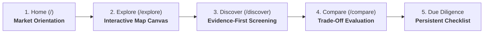

# Intelis — The Market, Understood.

**Intelis** is a market intelligence and location strategy platform designed to help prospective café founders, specialty coffee roasters, and restaurant operators evaluate location decisions in Indian cities—grounded strictly in real, verifiable open geospatial records.

> **Current Scope:** Hyderabad, India · Cafes & Coffee Shops (`Initial Study Area: 626.6 km² Historical GHMC Boundary`).

---

## The Product Experience

Intelis answers a fundamental founder question:  
***"Where should I open a café in Hyderabad? Show me areas worth considering, explain why they're interesting, let me compare them, and guide my on-the-ground due diligence."***



### The 5 Core Pages

1. **Home / Landing (`/`):** Editorial market overview highlighting the verified Hyderabad baseline (**1,082** study-boundary cafes, **10,567** dining establishments, and **796** scorable areas across 626.6 km²), a 3-step decision flow, live Top-3 candidate highlights, and core analytical honesty boundaries.
2. **Explore Market (`/explore`):** High-performance interactive MapLibre GL JS spatial canvas. Allows prospective founders to inspect H3 Resolution-8 hexagonal choropleths, filter individual food businesses, toggle analytical lenses (*Competition Whitespace, Cafe Density, Food Density*), and inspect micro-market POIs.
3. **Discover Locations (`/discover`):** Evidence-driven screening of 796 eligible areas across three strategic founder presets:
   - **Pioneer / First-Mover (60% Whitespace / 25% Food Context / 15% Reliability):** Maximises inverse observed café density per km² to locate unserved pockets with zero or minimal existing cafes.
   - **Balanced Opportunity (40% Whitespace / 35% Food Context / 25% Reliability):** Default baseline balancing competitive spacing with established dining anchors and data coverage.
   - **High-Activity Hub (20% Whitespace / 55% Food Context / 25% Reliability):** Prioritises high dining establishment density per km² for differentiated specialty concepts competing directly alongside existing cafes.
4. **Compare (`/compare`):** Side-by-side trade-off analysis comparing up to 3 candidate areas against the GHMC median across observed supply, dining context, coverage, and data quality. Features plain-English trade-off summaries and avoids declaring an automated &ldquo;winner&rdquo;.
5. **Methodology & Provenance (`/methodology`):** Complete technical disclosure of Overture Maps provenance, H3 hexagonal grid indexing, geometric boundary clipping, scoring formulas, and supply-side constraints.

---

## Analytical Honesty & Core Caveats

1. **Observed Supply $\neq$ Consumer Demand:** Intelis measures *observed commercial business supply* and spatial clustering from Overture Maps. It does **not** measure footfall volume, consumer purchasing power, sales revenue, or commercial rent.
2. **Whitespace $\neq$ Guaranteed Commercial Success:** An area with zero recorded cafes indicates an absence of recorded competitors in open datasets; it does not guarantee customer willingness to pay or viable retail trade.
3. **Informal Hospitality Blind Spots:** Local tea stalls, unmapped street kiosks, and informal eateries are generally absent from open geospatial databases and must be verified on foot.
4. **Historical Boundary Reference:** The clipping boundary is a January 2018 historical OpenStreetMap export of the GHMC boundary (626.6 km²), serving as a reproducible analytical unit rather than a legally current municipal administrative boundary.

---

## Technology Stack

| Layer | Technologies | Role |
| --- | --- | --- |
| **Frontend** | Next.js 15 (App Router), React 19, TypeScript, Tailwind CSS, shadcn/ui | Editorial light-themed web application |
| **Geospatial Visualisation** | MapLibre GL JS 6 | Vector tile rendering, H3 Res-8 hexagonal polygons, clustering |
| **Charts & Visualisation** | Apache ECharts 5 | Percentile profiles, multi-category counts, and density curves |
| **Backend API** | Python 3.13, FastAPI, Pydantic v2 | Read-only high-performance spatial analytics REST API |
| **Analytical Query Engine** | DuckDB 2.0 | High-speed vectorized Parquet & GeoJSON querying |
| **Data Engineering** | Pandas, GeoPandas, Shapely, PyArrow, Uber H3 | Ingestion, spatial joins, geometric clipping (EPSG:32644) |

---

## Local Development & Quickstart

### Prerequisites
- Node.js $\ge 20$ (v23 recommended)
- Python $\ge 3.11$ (v3.13 recommended)

### 1. Backend Setup (`apps/api`)

```bash
cd apps/api
python3 -m venv .venv
source .venv/bin/activate
pip install -e ".[dev]"
cp .env.example .env
uvicorn app.main:app --reload --host 127.0.0.1 --port 8000
```

Verify backend health:
```bash
curl http://127.0.0.1:8000/api/v1/health
```

Run backend unit tests:
```bash
pytest -v tests
ruff check app tests
```

### 2. Frontend Setup (`apps/web`)

```bash
cd apps/web
npm install
cp .env.example .env.local
npm run dev
```

Open `http://localhost:3000` in your browser. The header status badge will verify connectivity with the FastAPI backend.

Run frontend typecheck and production build:
```bash
npm run typecheck
npm run build
```

### 3. Data Pipeline & Reproduction (`pipelines`)

To re-run the offline data transformation and reproduce the exact Parquet datasets:

```bash
cd pipelines
python3 -m venv .venv
source .venv/bin/activate
pip install -e ".[dev]"
python -m pipelines.run_all
pytest -v tests
```

---

## Data Distribution & Curated Artefacts

To maintain a fast, clean Git history, large raw downloads and generated binary Parquet datasets are excluded from Git via `.gitignore`.

### Dataset Footprint
- `data/raw/` (~199.2 MB GeoJSON raw downloads): **Excluded from Git**
- `data/processed/` (~17.4 MB curated runtime Parquet/GeoJSON artefacts): **Excluded from Git**
- `data/manifests/` (tracked checksums, timestamps, source provenance): **Tracked in Git**

### Distribution Strategy for Production
1. **Local Pipeline Reproduction:** Running `python -m pipelines.run_all` recreates all 8 curated Parquet and GeoJSON files in `data/processed/` in ~3 seconds from raw data.
2. **Cloud Storage / GitHub Releases:** For automated deployments (e.g., Vercel + Render/Railway), the compressed 17.4 MB bundle (~4.2 MB `.tar.gz`) is stored as an asset in GitHub Releases and automatically unpacked during deployment via `scripts/download_data.sh`.

---

## Repository Structure

```
intelis/
├── apps/
│   ├── api/                   # FastAPI backend service
│   │   ├── app/
│   │   │   ├── api/v1/        # REST route handlers (cities, zones, opportunities, health)
│   │   │   ├── core/          # App configuration and settings
│   │   │   ├── schemas/       # Pydantic v2 response and request schemas
│   │   │   └── services/      # DuckDB query service and opportunity scoring engine
│   │   └── tests/             # Pytest test suite for API endpoints
│   └── web/                   # Next.js 15 frontend application
│       ├── src/
│       │   ├── app/           # App router: /, /explore, /discover, /compare, /methodology
│       │   ├── components/    # UI primitives, MapCanvas, ECharts, AppShell
│       │   └── lib/           # API clients, location labeling utilities
│       └── public/            # MapLibre web worker and static assets
├── data/
│   ├── manifests/             # Tracked provenance manifests and schema checksums
│   ├── processed/             # Curated runtime datasets (git-ignored, 17.4 MB)
│   └── raw/                   # Raw boundary and Overture extractions (git-ignored, 199 MB)
├── docs/                      # Architectural, geospatial, and methodology documentation
└── pipelines/                 # DuckDB & GeoPandas transformation scripts and test suite
```

---

## License

This project is licensed under the MIT License. Data derived from Overture Maps is subject to the CDLA Permissive v2.0 license. Boundary data from OpenStreetMap is subject to the Open Database License (ODbL).
