# Intelis — Architecture Proposal

**Product:** Intelis — The Market, Understood.  
**Decision Record:** Replaces the rejected Streamlit-based prototype proposal with a production-oriented, custom-frontend web application backed by a dedicated Python analytics API.

### Phase 1 MVP Scope & Deferred Infrastructure

For the initial four-day MVP (**Hyderabad, India — Cafes & Coffee Shops**), Intelis uses a lean, modular file-backed analytical stack (**DuckDB + Pandas + Parquet/GeoParquet** in `pipelines/` and `data/processed/`) served through **FastAPI** (`apps/api`) to **Next.js** (`apps/web`).

The following infrastructure is **intentionally deferred** until data scale or product requirements make it essential, while keeping service/repository boundaries clean so it can be introduced without rewriting frontend or route contracts:
- PostgreSQL / PostGIS (deferred; DuckDB + GeoParquet handles single-city MVP analytics cleanly)
- Docker / docker-compose (deferred for local MVP development)
- Redis caching, authentication/RBAC, and microservices (deferred)

---

## 1. System Architecture Overview

Intelis is structured into three decoupled layers:

1. **Presentation Layer (`apps/web`)** — Custom Next.js (App Router) + React + TypeScript application styled with Tailwind CSS and shadcn/ui primitives. Renders interactive vector/GeoJSON maps via MapLibre GL JS and analytical visualisations via Apache ECharts. Communicates with the backend strictly over versioned JSON/GeoJSON REST endpoints.
2. **Analytics API Layer (`apps/api`)** — Thin, async-capable Python FastAPI service exposing typed, documented endpoints (`/api/v1/...`). Route handlers perform only request validation, auth/rate-limiting hooks, and response serialisation; all business logic and geospatial queries live in dedicated service and repository modules.
3. **Data Engineering & Storage Layer (`pipelines/` + PostgreSQL/PostGIS)** — Offline/scheduled Python pipelines using DuckDB, PyArrow, Pandas, and GeoPandas to ingest, clean, harmonise, spatially join, and validate real datasets into Parquet artefacts and curated PostGIS tables.

```mermaid
flowchart LR
    subgraph DataSources["Real Data Sources (Documented Provenance)"]
        OSM["OSM / Overture Maps POIs & Roads"]
        Admin["Municipal Wards & Census Boundaries"]
        Pop["WorldPop / Kontur Population Grids"]
    end

    subgraph Pipelines["Data Engineering (pipelines/)"]
        Ingest["Ingest & Validate<br/>(DuckDB + PyArrow)"]
        Transform["Spatial Join & H3/Ward Aggregation<br/>(GeoPandas + Pandas)"]
        Publish["Load Curated Tables & Parquet"]
    end

    subgraph Storage["Managed Database"]
        PG["PostgreSQL + PostGIS<br/>(Indexed Geometries & Metrics)"]
    end

    subgraph Backend["Analytics API (apps/api)"]
        Routes["FastAPI Routes (Thin)"]
        Services["Domain Services & Scoring"]
        Repos["Spatial Repositories (SQL/PostGIS)"]
    end

    subgraph Frontend["Custom Web App (apps/web)"]
        Next["Next.js + React + TS<br/>(Tailwind + shadcn/ui)"]
        Map["MapLibre GL JS"]
        Charts["Apache ECharts"]
    end

    DataSources --> Ingest --> Transform --> Publish --> PG
    PG --> Repos --> Services --> Routes
    Routes -- "HTTPS JSON / GeoJSON / MVT" --> Next
    Next --> Map
    Next --> Charts
```



---

## 2. Architectural Principles & Non-Negotiables

1. **Strict Frontend/Backend Separation:** `apps/web` never connects directly to PostgreSQL. All data access flows through the FastAPI contract, verified with OpenAPI-generated TypeScript types.
2. **Data Processing Isolated from API Routes:** Heavy ETL, geometry cleaning, spatial indexing, and multi-dataset joins execute in `pipelines/`, never inside HTTP request handlers. API endpoints query pre-aggregated PostGIS tables or lightweight indexed spatial operations (e.g., bounding-box filtering, radius lookups, ward comparisons).
3. **Zero Fabricated Data:** Every entity and metric traces back to a versioned source manifest (`data/manifests/`). Where coverage is sparse or unavailable for a ward/category, the API returns explicit `null` values and data-completeness metadata rather than imputed or fabricated figures.
4. **Multi-City & Multi-Category Extensibility:** All core tables and API routes are parameterised by `city_slug` and `category_slug`. Adding a new Indian city or business vertical requires running the ingestion pipeline for that city/category configuration—not rewriting schemas or UI components.
5. **Manageable MVP Scope:** Launch with **one Indian city** (e.g., Bengaluru or Hyderabad) and **1–2 business categories** (e.g., Cafés & Quick-Service Restaurants, or Specialty Clinics) with full provenance, real spatial layers, and interactive comparison workflows before expanding.

---

## 3. Proposed Repository & Folder Structure

A clean monorepo layout keeps frontend, backend, pipelines, and documentation co-located while preserving clear build and deployment boundaries:

```text
intelis/
├── README.md
├── docs/
│   ├── architecture.md               # This document
│   ├── design-system.md              # Visual identity, palette, map & chart tokens
│   ├── data-dictionary.md            # (Planned) Source provenance & transformation specs
│   └── api-contract.md               # (Planned) Endpoint contracts & examples
│
├── apps/
│   ├── web/                          # Next.js (App Router) frontend — deployed to Vercel
│   │   ├── public/                   # Static assets, map sprites/glyphs if self-hosted
│   │   ├── src/
│   │   │   ├── app/                  # App Router pages & layouts (explore, compare, methodology)
│   │   │   ├── components/
│   │   │   │   ├── ui/               # shadcn/ui primitives (customised to Intelis light theme)
│   │   │   │   ├── map/              # Reusable MapLibre GL JS layers, controls, popups, legends
│   │   │   │   ├── charts/           # Reusable Apache ECharts wrappers & responsive containers
│   │   │   │   └── layout/           # App shell, navigation, filter rail, inspector drawer
│   │   │   ├── features/             # Domain-specific views (city-explorer, ward-inspector, comparison)
│   │   │   ├── lib/                  # API client, generated OpenAPI types, formatters, colour scales
│   │   │   └── styles/               # Tailwind config & semantic CSS variables
│   │   ├── tests/                    # Vitest unit tests + Playwright E2E specs
│   │   ├── package.json
│   │   └── next.config.ts
│   │
│   └── api/                          # Python FastAPI backend — deployed to container/PaaS host
│       ├── app/
│       │   ├── main.py               # FastAPI app factory, CORS, middleware, health checks
│       │   ├── core/                 # Settings (Pydantic), logging, DB pool, error handlers
│       │   ├── api/
│       │   │   └── v1/               # Thin route modules (cities, categories, zones, pois, analytics)
│       │   ├── schemas/              # Pydantic v2 request/response & GeoJSON models
│       │   ├── services/             # Domain logic (opportunity analysis, comparisons, summaries)
│       │   └── repositories/         # Parameterised PostGIS/SQLAlchemy queries
│       ├── alembic/                  # Database schema migrations
│       ├── tests/                    # pytest unit, integration, and API contract tests
│       ├── Dockerfile
│       └── pyproject.toml
│
├── pipelines/                        # Standalone data engineering package (never imported by routes)
│   ├── intelis_pipelines/
│   │   ├── config/                   # Per-city & per-category YAML configs
│   │   ├── ingest/                   # Source downloaders & DuckDB/PyArrow readers
│   │   ├── transform/                # GeoPandas spatial joins, ward/H3 aggregation, cleaning
│   │   ├── validate/                 # Data quality assertions (geometry validity, nulls, provenance)
│   │   └── load/                     # PostGIS bulk loader & Parquet exporter
│   ├── tests/                        # Pipeline transformation & data-quality tests
│   └── pyproject.toml
│
├── data/                             # Local gitignored working data + tracked manifests
│   ├── manifests/                    # Tracked JSON/YAML provenance records (source URL, license, date)
│   ├── raw/                          # Gitignored raw downloads
│   └── processed/                    # Gitignored intermediate Parquet files
│
├── infra/
│   ├── docker-compose.yml            # Local PostGIS + API dev environment
│   └── scripts/                      # Seed, migration, and typegen helper scripts
└── .github/
    └── workflows/                    # CI: lint, typecheck, pytest, vitest, build
```

---

## 4. Data Model & Geospatial Strategy

### Core Relational + PostGIS Schema (Multi-City & Multi-Category)

- `cities` — `id`, `slug`, `name`, `state`, `bbox` (Polygon, EPSG:4326), `center` (Point), `default_zoom`, `metadata` (JSONB).
- `categories` — `id`, `slug`, `name`, `parent_slug`, `osm_tag_mapping` (JSONB), `accent_token`.
- `spatial_units` — `id`, `city_id`, `unit_type` (`ward` | `hex_res8` | `locality`), `unit_code`, `name`, `geom` (MultiPolygon, GIST-indexed), `area_sq_km`, `source_dataset_id`.
- `pois` — `id`, `city_id`, `category_id`, `external_id`, `source_dataset_id`, `name`, `geom` (Point, GIST-indexed), `attributes` (JSONB), `captured_at`.
- `unit_category_metrics` — Pre-computed analytical table keyed by `(spatial_unit_id, category_id, snapshot_date)`: POI count, density per km², nearest-competitor median distance, population-to-POI ratio (where population data exists), data-completeness score, and transparent sub-indicators.
- `datasets` — Provenance registry (`id`, `name`, `provider`, `license`, `url`, `retrieved_at`, `transformation_version`, `notes`).

### Map Rendering Strategy

- **MVP (Ward & H3 Choropleths + Filtered POIs):** Serve simplified GeoJSON (quantised coordinates via `ST_SimplifyPreserveTopology`) for city-level ward/hex grids (typically 150–600 polygons per Indian metro—fast to transfer and filter client-side in MapLibre GL JS), plus viewport-bounded GeoJSON or clustered points for POIs.
- **Scale Path:** When multi-city POI counts exceed ~50k visible points, serve Mapbox Vector Tiles (MVT) directly from PostGIS using `ST_AsMVT` through a cached FastAPI tile endpoint (`/api/v1/tiles/{z}/{x}/{y}.pbf`)—no separate tile server required for moderate scale.

---

## 5. Dependency Requirements

### Local Development Prerequisites
- **Node.js** 20+ (LTS) or 22+ (currently `v23.11.0` installed locally) and `npm` (or `pnpm`).
- **Python** 3.12+ (currently `3.13.7` installed locally); `uv` recommended for fast virtualenvs and lockfiles (fallback: `pip` + `venv`).
- **Docker** (currently `29.0.1` installed locally) for running local `postgis/postgis:16-3.4`.
- **GDAL/GEOS/PROJ** (bundled in modern `pyogrio`/`shapely`/`geopandas` binary wheels on macOS/Linux; verify on Python 3.13 before locking versions).

### Frontend (`apps/web`)
- **Core:** `next`, `react`, `react-dom`, `typescript`
- **Styling & UI:** `tailwindcss`, `class-variance-authority`, `clsx`, `tailwind-merge`, `lucide-react`, `@radix-ui/*` (via `shadcn/ui`)
- **Geospatial:** `maplibre-gl` (and optionally `react-map-gl/maplibre` for declarative React bindings)
- **Charts:** `echarts` (with thin custom React resize/theme wrapper)
- **Data Fetching & Types:** `@tanstack/react-query`, `openapi-typescript` (dev)
- **Testing & Linting:** `vitest`, `@testing-library/react`, `@playwright/test`, `eslint`, `prettier`

### Backend (`apps/api`)
- **Core:** `fastapi`, `uvicorn[standard]`, `pydantic`, `pydantic-settings`
- **Database:** `sqlalchemy[asyncio]`, `asyncpg`, `geoalchemy2`, `alembic`, `psycopg[binary]` (for migrations/sync scripts)
- **Testing & Linting:** `pytest`, `pytest-asyncio`, `httpx`, `ruff`, `mypy`

### Data Engineering (`pipelines/`)
- **Core:** `pandas`, `geopandas`, `duckdb`, `pyarrow`, `shapely`, `pyogrio`
- **Spatial Indexing (Optional for hex grids):** `h3`
- **Validation & DB Load:** `pandera` (or custom Pydantic/DuckDB checks), `psycopg[binary]`, `sqlalchemy`

---

## 6. Development & Deployment Strategy

### Local Development Workflow
1. Run PostgreSQL + PostGIS locally via `docker compose up -d db`.
2. Run Alembic migrations (`alembic upgrade head`) and execute a repeatable pipeline run for the MVP city to populate real data.
3. Run FastAPI locally (`uvicorn app.main:app --reload --port 8000`) with OpenAPI schema exported at `/openapi.json`.
4. Generate TypeScript API types in `apps/web` from the FastAPI OpenAPI schema so frontend/backend contracts stay in sync.
5. Run Next.js locally (`npm run dev` on port `3000`) proxying or calling `NEXT_PUBLIC_API_URL`.

### Testing & Maintainability Strategy
- **Data Pipelines:** Automated validation checks on every run (valid geometries, CRS = EPSG:4326, zero fabricated rows, non-empty provenance metadata, reproducible row counts).
- **Backend API:** `pytest` suite against a test PostGIS container covering spatial queries, edge cases (empty bounds, unknown city/category, null metrics), and response schemas.
- **Frontend:** Vitest component tests for reusable chart/filter/formatting utilities + Playwright smoke tests verifying map load, ward selection, and comparison flows.
- **CI (GitHub Actions):** Runs Ruff + mypy + pytest (`api` & `pipelines`) and ESLint + TypeScript check + Vitest + Next.js build (`web`) on every pull request.

### Deployment Architecture

| Component | Recommended Provider | Rationale |
| --- | --- | --- |
| **Frontend (`apps/web`)** | **Vercel** | Native Next.js App Router support, preview deployments per PR, global edge CDN. |
| **Backend (`apps/api`)** | **Render** or **Railway** (or **Fly.io**) | Simple Docker-based Python/FastAPI hosting, predictable pricing, easy environment/secret management, close proximity to managed DB. |
| **Database (PostgreSQL + PostGIS)** | **Neon** or **Supabase** (Postgres only) | Managed PostgreSQL with built-in PostGIS extension (`CREATE EXTENSION postgis;`), generous free/starter tier, branching (Neon), automated backups. |
| **Data Pipelines (`pipelines/`)** | Local / GitHub Actions scheduled jobs | Pipelines run offline/on-demand and push curated snapshots to managed PostGIS—avoiding paying for an always-on heavy compute server. |
| **Basemap Tiles** | **OpenFreeMap** or **Protomaps** (self-hosted PMTiles on Cloudflare R2) or **MapTiler** (free tier) | Clean, customisable light-themed vector basemaps compatible with MapLibre GL JS without Mapbox lock-in. |

---

## 7. Technical Risks & Cost Considerations

### Technical Risks & Mitigations
1. **Python 3.13 Wheel Compatibility for Geospatial Packages:** Local Python is `3.13.7`. While Pandas, PyArrow, DuckDB, and Shapely have 3.13 wheels, some geospatial/database packages occasionally lag on bleeding-edge Python versions.  
   *Mitigation:* Pin **Python 3.12** in Dockerfiles and CI (and optionally via `pyenv`/`uv` locally) for maximum ecosystem stability.
2. **Real Indian Dataset Quality & Boundary Mismatches:** Municipal ward boundaries, Census data, and OSM POI completeness vary significantly across Indian cities (e.g., OSM density is high in central Bengaluru/Mumbai/Hyderabad, sparser in peripheral wards).  
   *Mitigation:* Start MVP with a well-mapped metro (e.g., Bengaluru), document every source and capture date in `data/manifests/`, and display explicit data-completeness indicators in the UI.
3. **Cold Starts on Free-Tier Python Hosting:** Free tiers on Render/Railway sleep after inactivity, causing 15–30s initial API latency on portfolio demos.  
   *Mitigation:* Use a low-cost always-on starter instance (\$5–\$7/month) for production demos, or add clear loading states and client-side caching (`TanStack Query`) + HTTP `Cache-Control` headers for immutable city/ward summaries.
4. **Heavy GeoJSON Payloads Slowing Browser Rendering:** Unsimplified ward boundaries or 20k raw POI markers will degrade mobile/laptop frame rates.  
   *Mitigation:* Simplify polygons in PostGIS (`ST_SimplifyPreserveTopology`), strip unused properties, cluster POIs in MapLibre, and migrate to PostGIS `ST_AsMVT` tiles when scaling.
5. **MapLibre + Next.js SSR Hydration Issues:** MapLibre GL JS relies on browser WebGL APIs (`window`, `document`).  
   *Mitigation:* Isolate MapLibre components in `"use client"` modules loaded via `next/dynamic(..., { ssr: false })`.

### Cost Considerations (MVP / Portfolio Scale)
- **Vercel (Frontend):** \$0/month on Hobby tier.
- **Managed PostgreSQL + PostGIS (Neon / Supabase):** \$0/month on Free tier (sufficient for several Indian cities and hundreds of thousands of POIs; ~500 MB–1 GB storage). Upgrades to ~\$19–\$25/month when scaling.
- **Python FastAPI Hosting (Render / Railway / Fly.io):** \$0/month on Hobby/Free tier (with cold starts) or **\$5–\$7/month** for an always-on 512 MB–1 GB RAM container (recommended for responsive UX).
- **Vector Basemap Tiles:** \$0/month using OpenFreeMap, MapTiler free tier (up to 100k map loads/month), or self-hosted Protomaps PMTiles on Cloudflare R2 free tier.
- **Estimated Total MVP Operating Cost:** **\$0/month** (dev/demo with cold starts) to **~\$5–\$7/month** (smooth, always-on production demo).
